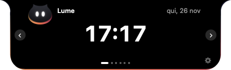
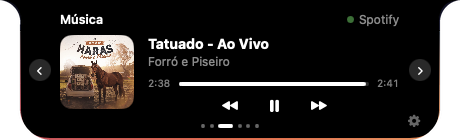

# Lume

[Português](README.pt-BR.md) · [Website](https://adrianogl.github.io/lume/en/)

Lume turns the top of your Mac's screen into a small, living notch. At rest it is just a pair of owl eyes with a thin warm rim. Hover it and it opens into cards: the time, your week, what's playing, your Claude Code sessions, your Claude usage and your pull requests. When something needs you, a pill drops down with what happened and a button to act on it.

<p align="center">
  <br><br>
  <br><br>
  
</p>

On a screen without a physical notch, Lume draws its own at the top center of the main display. So far it has only been tested on displays without a notch; reports from MacBooks with one are welcome.

The interface is in Brazilian Portuguese.

## Modules

Every module can be turned on and off on its own, from the Settings window (gear icon on the open notch) or from the config file.

| Module | What it shows |
| --- | --- |
| **Clock** | Time and date, with the owl mascot. |
| **Week** | The current week with a dot per event, the next event and a day detail view. Arrows or a vertical trackpad scroll move to other weeks. Alerts before an event (you pick how many minutes before), with sound and a small bounce. During an event, the closed notch shows how much time is left. Reads the macOS Calendar or an iCal link, recurring events included. |
| **Music** | Track, artist, artwork, progress and controls for Spotify and Apple Music. While music plays, the owl listens and small bars dance on the closed notch. |
| **Claude Code** | A pill when a session asks for permission, waits for your answer or finishes, with the session title. **Open** brings the right iTerm tab forward. A card keeps the recent alerts so nothing gets lost. Works with several accounts (`~/.claude`, `~/.claude-work`, …). |
| **Claude usage** | How much of the 5-hour and weekly limits each account has used and when each window resets. The closed notch shows the percentage once an account crosses 80%, and a pill warns at the thresholds you choose. |
| **Pull requests** | Your open PRs and the reviews requested from you, in one list ordered by what needs you: failing CI, ready to merge, changes requested, review requested. Alerts when that state changes. |

<p align="center">
  <br><br>
  
</p>

## Install

Requires macOS 14 (Sonoma) or later.

1. Download `Lume-<version>.zip` from [Releases](../../releases) and unzip it.
2. Move `Lume.app` to `Applications`.
3. The release is not notarized, so macOS blocks the first launch. Right-click `Lume.app` › **Open** › **Open**. If macOS still refuses, run:

   ```sh
   xattr -dr com.apple.quarantine /Applications/Lume.app
   ```

Lume has no Dock icon. It lives in the notch.

### Build from source

Requires Xcode 16 or the Swift 6 toolchain.

```sh
git clone https://github.com/adrianogl/lume.git
cd lume
./scripts/build-app.sh --install
```

`build-app.sh` builds a release binary, assembles `build/Lume.app` and signs it with your Apple Development certificate if you have one (ad-hoc otherwise). `--install` copies it to `~/Applications` and opens it. Set `LUME_SIGNING_IDENTITY` to pick another identity.

A stable signature matters: macOS ties the Calendar and Automation permissions to it, so with an ad-hoc signature it asks again after every build.

## Permissions

| Permission | Used by | Why |
| --- | --- | --- |
| Calendars | Week | Reads your events. Not needed if you use an iCal link. |
| Automation (Spotify, Music) | Music | Asks the player what's playing and sends play, pause and skip. |
| Automation (iTerm) | Claude Code | **Open** selects the iTerm tab of the session. |

## Claude Code integration

Both Claude modules are set up per account in Settings, and both keep a `settings.json.lume-backup` next to the original file the first time they touch it. Lume keeps the key order and formatting of your `settings.json`.

- **Claude Code alerts** add Lume as a hook (`Notification`, `Stop`, `UserPromptSubmit`, `PostToolUse`, `SessionEnd`). Existing hooks stay. **Remove** takes out only Lume's entries.
- **Claude usage** puts Lume in front of your status line. Claude Code sends the official usage numbers to the status line command on every update. Lume saves them and passes the same input to the command you already had, so your status line looks the same. **Remove** restores the original command. The numbers only update while a session of that account is open.

## Pull requests

The module uses the [GitHub CLI](https://cli.github.com) you already have logged in (`gh auth login`). Lume stores no token. It asks GitHub every 2 minutes (configurable) for your open PRs and the reviews requested from you. Drafts and bot PRs (Dependabot, Renovate) are hidden by default, and you can limit the list to some organizations or repositories.

## Configuration

Settings live in `~/.config/lume/config.json`. The Settings window writes it, and Lume picks up edits you make by hand right away. Every key is optional. See [`docs/config.example.json`](docs/config.example.json) for all of them with their defaults.

## Privacy

Everything stays on your Mac. Lume only goes to the network to download your iCal link (if you set one) and through `gh` for pull requests. It has no analytics and no telemetry.

## Releasing

```sh
./scripts/release.sh
```

It builds the app with an ad-hoc signature, zips it to `dist/Lume-<version>.zip` with its SHA-256, and prints the `gh release create` command. The version comes from `CFBundleShortVersionString` in `Resources/Info.plist`.

## Credits

The notch design follows the visual direction of [Nusa](https://rama2555.github.io/nusa/).

Claude and the Claude logo are trademarks of Anthropic. Lume is an independent project, not affiliated with or endorsed by Anthropic. Spotify, Apple Music, iTerm and GitHub are trademarks of their owners.

## License

[MIT](LICENSE)
