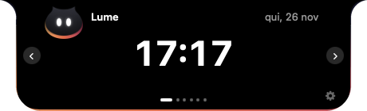
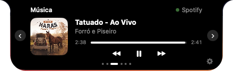

# Lume

[English](README.md) · [Site](https://adrianogl.github.io/lume/)

O Lume transforma o topo da tela do Mac num notch pequeno e vivo. Em repouso, é só um par de olhos de coruja com uma borda fina e quente. Passe o mouse e ele abre em cards: a hora, a sua semana, o que está tocando, as sessões do Claude Code, o uso do Claude e as suas pull requests. Quando algo precisa de você, desce uma pílula dizendo o que aconteceu, com um botão para agir.

<p align="center">
  <br><br>
  <br><br>
  
</p>

Em tela sem notch físico, o Lume desenha o próprio notch no centro do topo da tela principal. Até agora só foi testado em telas sem notch, então relatos de quem usa MacBook com notch são bem-vindos.

## Módulos

Cada módulo liga e desliga sozinho, pela janela de Ajustes (a engrenagem no notch aberto) ou pelo arquivo de configuração.

| Módulo | O que mostra |
| --- | --- |
| **Relógio** | Hora e data, com a coruja. |
| **Semana** | A semana com um pontinho por evento, o próximo compromisso e o detalhe de cada dia. As setas ou a rolagem vertical no trackpad levam para outras semanas. Avisa antes do evento (você escolhe quantos minutos antes), com som e um pulinho. Durante o evento, o notch fechado mostra quanto falta. Lê o Calendário do macOS ou um link iCal, inclusive eventos repetidos. |
| **Música** | Faixa, artista, capa, progresso e controles do Spotify e do Música. Enquanto toca, a coruja ouve junto e barrinhas dançam no notch fechado. |
| **Claude Code** | Uma pílula quando uma sessão pede permissão, espera sua resposta ou termina, com o título da sessão. **Abrir** traz para a frente a aba certa do iTerm. Um card guarda os avisos recentes para nada se perder. Funciona com várias contas (`~/.claude`, `~/.claude-trabalho`, …). |
| **Uso do Claude** | Quanto cada conta já usou dos limites de 5 horas e da semana e quando cada janela zera. O notch fechado mostra o percentual quando uma conta passa de 80%, e uma pílula avisa nos marcos que você escolher. |
| **Pull requests** | As suas PRs abertas e os reviews pedidos a você, numa lista só, na ordem do que precisa de você: CI falhou, pronta para merge, mudanças pedidas, review pedido. Avisa quando esse estado muda. |
| **Comandos** | Uma pílula quando um comando demorado do terminal termina (30 segundos ou mais, por padrão), dizendo se passou ou falhou e quanto levou. **Abrir** traz a aba certa do iTerm para a frente. Enquanto roda, o notch fechado mostra o tempo. Precisa do zsh. |

<p align="center">
  <br><br>
  
</p>

## Instalação

Precisa do macOS 14 (Sonoma) ou mais novo.

1. Baixe o `Lume-<versão>.zip` em [Releases](../../releases) e descompacte.
2. Mova o `Lume.app` para `Aplicativos`.
3. O release não é notarizado, então o macOS bloqueia a primeira abertura. Clique com o botão direito no `Lume.app` › **Abrir** › **Abrir**. Se o macOS ainda recusar, rode:

   ```sh
   xattr -dr com.apple.quarantine /Applications/Lume.app
   ```

O Lume não tem ícone no Dock. Ele fica no notch.

### Compilar do código

Precisa do Xcode 16 ou da toolchain do Swift 6.

```sh
git clone https://github.com/adrianogl/lume.git
cd lume
./scripts/build-app.sh --install
```

O `build-app.sh` compila em modo release, monta o `build/Lume.app` e assina com o seu certificado Apple Development, se você tiver um (senão, assina ad-hoc). O `--install` copia para `~/Applications` e abre. Use `LUME_SIGNING_IDENTITY` para escolher outra identidade.

Uma assinatura estável faz diferença: o macOS liga as permissões de Calendário e de Automação a ela, então com assinatura ad-hoc ele pergunta de novo a cada build.

## Permissões

| Permissão | Quem usa | Para quê |
| --- | --- | --- |
| Calendários | Semana | Lê os seus eventos. Não precisa se você usar um link iCal. |
| Automação (Spotify, Música) | Música | Pergunta ao player o que está tocando e manda tocar, pausar e trocar de faixa. |
| Automação (iTerm) | Claude Code | O **Abrir** seleciona a aba do iTerm da sessão. |

## Integração com o Claude Code

Os dois módulos do Claude são configurados conta por conta nos Ajustes. Na primeira vez que mexem no `settings.json`, os dois guardam uma cópia `settings.json.lume-backup` ao lado. O Lume mantém a ordem das chaves e a formatação do arquivo.

- **Avisos do Claude Code** adicionam o Lume como hook (`Notification`, `Stop`, `UserPromptSubmit`, `PostToolUse`, `SessionEnd`). Os hooks que já existem continuam lá. **Remover** tira só as entradas do Lume.
- **Uso do Claude** coloca o Lume na frente da sua status line. A cada atualização, o Claude Code manda para o comando da status line os números oficiais de uso. O Lume guarda esses números e repassa a mesma entrada para o comando que você já tinha, então a status line continua igual. **Remover** devolve o comando original. Os números só atualizam enquanto há uma sessão aberta naquela conta.

## Pull requests

O módulo usa o [GitHub CLI](https://cli.github.com) que você já tem logado (`gh auth login`). O Lume não guarda token. A cada 2 minutos (dá para mudar), ele busca no GitHub as suas PRs abertas e os reviews pedidos a você. Rascunhos e PRs de bot (Dependabot, Renovate) ficam de fora por padrão, e dá para limitar a lista a algumas organizações ou repositórios.

## Comandos

**Instalar**, nos Ajustes, cria `~/.config/lume/lume.zsh` e adiciona uma linha que carrega esse arquivo no fim do seu `~/.zshrc`, guardando uma cópia `.zshrc.lume-backup` na primeira vez. O script usa os hooks `preexec` e `precmd` do zsh e chama o Lume em segundo plano, então não atrasa o prompt nem muda o exit code. O Lume recebe só o texto do comando, a pasta, a duração e o exit code; a saída do comando nunca é lida. Comandos interativos como `vim`, `ssh`, `less` e `claude` são ignorados, e a lista é editável. **Remover** tira a linha e apaga o script. Terminais abertos antes da instalação precisam de uma aba nova.

## Configuração

Os ajustes ficam em `~/.config/lume/config.json`. A janela de Ajustes grava esse arquivo, e o Lume percebe na hora o que você editar à mão. Todas as chaves são opcionais. O [`docs/config.example.json`](docs/config.example.json) tem todas, com os valores padrão.

## Privacidade

Tudo fica no seu Mac. O Lume só acessa a rede para baixar o seu link iCal (se você configurar um) e, pelo `gh`, para as pull requests. O hook de comandos só manda dados para o próprio Lume, no seu Mac. Não tem analytics nem telemetria.

## Como gerar um release

```sh
./scripts/release.sh
```

O script compila o app com assinatura ad-hoc, gera o `dist/Lume-<versão>.zip` com o SHA-256 e mostra o comando `gh release create`. A versão vem do `CFBundleShortVersionString` em `Resources/Info.plist`.

## Créditos

O visual do notch segue a linha do [Nusa](https://rama2555.github.io/nusa/).

Claude e o logo do Claude são marcas da Anthropic. O Lume é um projeto independente, sem vínculo com a Anthropic e sem o endosso dela. Spotify, Apple Music, iTerm e GitHub são marcas dos seus donos.

## Licença

[MIT](LICENSE)
